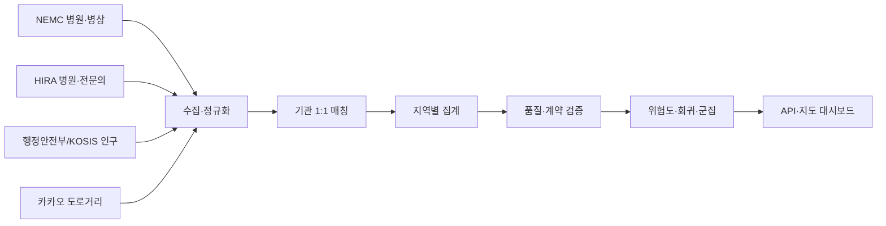

# Case A. 응급의료 데이터 파이프라인과 QA

## 1. 문제

지역별 응급의료 위험도를 계산하려면 병원 기본정보, 실시간 병상, 인구, 전문의, 도로 접근성 데이터를 결합해야 합니다. 하지만 원천마다 기관 식별자, 행정구역 기준, 갱신주기와 결측 의미가 달랐습니다.

대표적인 문제는 다음과 같았습니다.

- NEMC의 `hpid`와 HIRA의 암호화 요양기호가 달라 단순 JOIN 불가
- 같은 병원도 법인명 포함 여부나 주소 표기가 달라 문자열 완전일치 실패
- HIRA 미매칭과 전문의 0명이 데이터상 구분되지 않으면 위험도 왜곡
- 병상 API가 일부 지역에서 실패하거나 응답 기관 수가 급감할 수 있음
- 인구·경계·도로거리의 기준 시점이 다르면 서로 다른 세대의 결과가 혼합됨

## 2. 파이프라인

주요 산출물:

- `hospital_master.csv`: 기준 병원 모집단
- `hira_doctor_matches.csv`: 기관 매칭과 전문의 조회 결과
- `missingness_followup.csv`: 결측 원인, 우선순위, 다음 조치
- `region_risk_final.csv`: 지역별 원천값·구성점수·최종 위험도
- `regression_result.csv`, `cluster_result.csv`: 분석 결과

## 3. 데이터 결합 전략

### 기준 모집단 보존

NEMC 기관을 분석 모집단으로 두고 HIRA를 LEFT JOIN 보강 원천으로 사용했습니다. HIRA에서 찾지 못한 병원도 NEMC 목록에서는 제거하지 않고 전문의 관련 값만 결측으로 유지했습니다.

### 기관 1:1 매칭

병원명 하나만 비교하지 않고 다음 특성을 함께 사용했습니다.

- 정규화된 병원명
- 시군구와 도로명주소
- 전화번호
- 위·경도
- 의료기관 종별

동일 HIRA 식별자가 여러 NEMC 병원에 중복 배정되지 않도록 전역 1:1 배정을 적용했습니다. 자동 확정이 어려운 후보는 강제 연결하지 않고 저유사도·검색 결과 없음 파일로 분리했습니다.

## 4. QA와 문제 해결

### 결측 정책

- HIRA 미매칭은 전문의 0명이 아니라 `알 수 없음`으로 처리
- 지역 매칭률이 80% 미만이면 전문의 합계를 신뢰하지 않고 해당 점수를 결측 처리
- 전체병상 0·누락, 음수 가용병상은 유효하지 않은 관측으로 처리
- 네 구성점수 중 하나라도 없으면 종합위험도를 임의 생성하지 않고 `원천데이터부족` 표시

### API 부분 실패

일부 지역의 timeout이나 5xx 때문에 전국의 정상 응답을 폐기하지 않도록 마지막 정상값을 원래 수집시각과 함께 유지했습니다. 다만 응답 기관 수가 안전 기준 아래로 급감하면 fallback으로 통과시키지 않고 전체 갱신을 중단했습니다.

### 원자적 배포

새 산출물은 staging 디렉터리에서 다음 계약을 검사한 뒤 한 세대로 승격합니다.

- 기관코드와 지역키 유일성
- 병상 수치 범위와 기관 수 하한
- HIRA 식별자 1:1 관계
- 원천과 결측 리포트의 일치
- 위험도·등급·경계의 지역 집합 일치

검증 실패 시 live 파일 일부만 교체하지 않고 마지막 정상 세대를 계속 제공합니다.

## 5. 분석 및 결과 검증

- 원천 수치로 선형회귀를 수행해 구성점수의 가중합을 그대로 재학습하는 순환논리를 피함
- 상관계수와 VIF로 독립변수 간 다중공선성 확인
- K-Means 후보 k를 비교한 뒤 지역별 의료 취약 유형 생성
- 접근성 산식이 직선거리에서 카카오 도로거리로 바뀌면 위험도·회귀·군집 결과를 모두 같은 세대로 재생성

## 6. 직무와의 연결

이 프로젝트에서 중요한 것은 지도 UI보다 **데이터가 틀린 상태로 다음 단계에 전달되지 않게 만든 과정**입니다. 유관부서의 요청을 데이터 계약으로 구체화하고, 제공 전에 정확성·완전성·신선도·일관성을 검사하는 Bees T&A 업무와 직접 연결됩니다.

