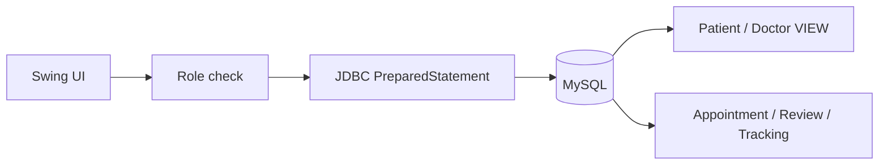

# DByte — SQL/JDBC Data Service

> 의료 서비스의 역할별 요구를 관계형 데이터 조회·집계 조건으로 바꾼 학업용 Java/JDBC 프로젝트입니다.

[Source repository](https://github.com/Westyoon/DByte) · [Contribution history](https://github.com/Westyoon/DByte/commits/main/?author=Westyoon)

## Project info

| Item | Detail |
|---|---|
| Period | 2025.05 - 2025.06 |
| Team | 4-person team |
| My role | 프로젝트 초기 구조, 건강 tracking CRUD·ROLLUP, 메인 GUI·기능 통합, 상담 기록 콘솔 흐름 개선 |
| Stack | Java, MySQL, JDBC, Swing |
| Run status | DB schema·migration·seed가 없어 현재 저장소만으로는 재현 불가 |

## Executive summary

| Item | Detail |
|---|---|
| Question | 환자·의사·기관별로 허용된 기록과 통계를 어떻게 조회·수정할까? |
| Contribution | 건강 tracking CRUD·ROLLUP, `MainGUI`·기능 통합, 상담 기록 콘솔 흐름 개선 |
| SQL | SELECT/INSERT/UPDATE/DELETE, JOIN, subquery, VIEW, CTE, window function, GROUP BY |
| Access layer | JDBC `PreparedStatement`, 역할별 조건 분기 |
| Scope | 학업용 로컬 MySQL 프로토타입; 분석 warehouse나 운영 서비스로 표현하지 않음 |

## Requirements translated into queries

| User need | Query design |
|---|---|
| 환자가 자신의 상담 기록 확인 | `PatientView`에서 `userId` 조건 조회 |
| 의사가 소속 기관의 기록 관리 | `Medical`에서 기관을 확인한 뒤 `DoctorView` 조회 |
| 기관별 리뷰 품질 비교 | `AVG(rating)` window function과 `RANK()` |
| 기관·사용자별 리뷰 통계 | `COUNT`, `AVG`, `GROUP BY`, `HAVING` |
| 처방 전 알레르기 확인 | 환자 ID로 알레르기 조회 후 처방 문자열 대조 |
| 건강 기록 시간순 확인 | 사용자·기관 권한 확인 후 날짜 정렬 |

## Architecture



## Example query pattern

기관 평균 평점과 순위를 한 번에 제공하기 위해 CTE와 window function을 사용했습니다.

```sql
WITH review_with_avg AS (
    SELECT
        review_id,
        institution_id,
        rating,
        AVG(rating) OVER (PARTITION BY institution_id) AS institution_avg
    FROM Reviews
)
SELECT
    review_id,
    institution_id,
    rating,
    institution_avg,
    RANK() OVER (ORDER BY institution_avg DESC) AS institution_rank
FROM review_with_avg;
```

입력값은 문자열 연결 대신 `PreparedStatement` 파라미터로 바인딩했습니다.

## Troubleshooting

아래는 팀 프로젝트 전체의 문제 해결입니다. 알레르기 ID 수정과 리뷰 window query는 각각 다른 팀원의 구현이며, 개인 기여와 구분해 표시합니다.

### 1. 알레르기 검사가 잘못된 ID를 기준으로 동작했습니다

- **Problem:** 상담 기록 수정 시 알레르기 충돌 검사가 환자가 아니라 appointment ID 흐름에 묶여 있었습니다.
- **Root cause:** 처방 검증에 필요한 실제 patient ID를 먼저 조회하지 않았습니다.
- **Options considered:** 화면에서 patient ID를 다시 전달하거나 appointment에서 patient를 조회하는 방식을 비교했습니다.
- **Fix:** appointment ID로 `userId`를 조회한 뒤 해당 환자의 알레르기와 처방을 대조했습니다.
- **Result:** 기록 수정 경로에서도 등록 경로와 같은 환자 기준 검사가 동작하게 됐습니다.

Evidence: 팀원 aJISUa의 [`3f9871e`](https://github.com/Westyoon/DByte/commit/3f9871e)

### 2. 환자와 의사의 조회 범위가 같은 코드에 섞여 있었습니다

- **Problem:** 사용자 역할에 따라 보여야 할 상담 기록 범위가 달랐습니다.
- **Root cause:** 사용자 ID만으로 조회하면 의사의 소속 기관 조건을 적용할 수 없었습니다.
- **Fix:** 환자는 `PatientView`, 의사는 소속 기관을 조회한 뒤 `DoctorView`를 사용하도록 분기했습니다.
- **Result:** 역할별 조회 의도를 SQL 조건으로 명시할 수 있게 됐습니다.

### 3. 기관 평균만으로는 리뷰 비교 순서를 제공하기 어려웠습니다

- **Problem:** 기관별 평균과 전체 순위를 별도 쿼리로 계산하면 중복 로직이 생겼습니다.
- **Fix:** CTE에서 기관별 window average를 만들고 `RANK()`로 순위를 계산했습니다.
- **Result:** 한 조회에서 리뷰, 기관 평균과 순위를 함께 제공했습니다.

Evidence: 팀원 Alimeeeeeee의 [`InstitutionReview.java`](https://github.com/Westyoon/DByte/blob/main/source/InstitutionReview.java)

## Evidence map

### My contribution

| Area | Evidence |
|---|---|
| 건강 tracking CRUD·ROLLUP | [`06dd5da`](https://github.com/Westyoon/DByte/commit/06dd5da) |
| `MainGUI` 생성과 기능 통합 | [`05e6504`](https://github.com/Westyoon/DByte/commit/05e6504) |
| 상담 기록 콘솔 흐름 개선 | [`654c393`](https://github.com/Westyoon/DByte/commit/654c393) |

### Team implementation

| Capability | Source |
|---|---|
| 역할별 상담 기록, VIEW, 처방·알레르기 확인 | [`AppointmentRecordsql.java`](https://github.com/Westyoon/DByte/blob/main/source/AppointmentRecordsql.java) |
| 리뷰 CRUD, CTE·window function, 집계 | [`InstitutionReview.java`](https://github.com/Westyoon/DByte/blob/main/source/InstitutionReview.java) |
| 건강 추적 기록 | [`Tracking.java`](https://github.com/Westyoon/DByte/blob/main/source/Tracking.java) |
| 화면 통합 | [`MainGUI.java`](https://github.com/Westyoon/DByte/blob/main/source/MainGUI.java) |

## Limitations and next steps

- 저장소에 완전한 DB schema, migration과 seed가 없어 처음부터 재현 가능한 패키지는 아닙니다.
- 연결 정보가 코드에 있는 학업용 구조입니다. 운영 환경이라면 환경변수·secret manager와 connection pool로 분리해야 합니다.
- 알레르기 문자열 비교는 방향과 복수 처방 parsing을 다시 검증하고 의약품 코드 기준으로 바꿔야 합니다.
- 리뷰 행마다 기관 평균이 반복된 상태에서 `RANK()`를 적용해 순위가 건너뛸 수 있으므로 기관 단위 subquery 또는 `DENSE_RANK()` 검토가 필요합니다.
- 메서드가 UI와 데이터 접근을 함께 담당합니다. repository/service 계층 분리가 필요합니다.
- 권한 검사는 애플리케이션 분기뿐 아니라 DB 권한과 테스트로 보강해야 합니다.
- 대규모 분석 쿼리의 실행계획, index와 성능 검증은 범위에 포함되지 않았습니다.

이 케이스는 완성된 운영 시스템보다 **사용자 요구를 키·필터·JOIN·집계로 번역한 SQL 기초 경험**의 근거로 사용합니다.

[← Portfolio home](../../README.md)
