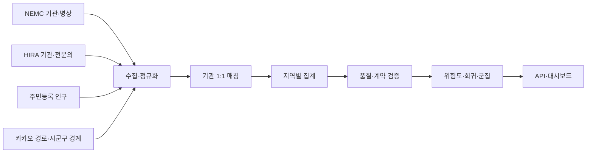

# Emergency Medical Capacity — Data Pipeline & QA

> 서로 다른 기관 식별자와 갱신주기를 가진 의료 데이터를 결합해 지역별 응급의료 취약도를 계산하고, 잘못된 데이터가 분석과 화면으로 전달되지 않도록 검증한 프로젝트입니다.

[Source repository](https://github.com/Westyoon/embulance_score) · [Data pipeline](https://github.com/Westyoon/embulance_score/blob/main/DATA_PIPELINE.md) · [Analysis report](https://github.com/Westyoon/embulance_score/blob/main/ANALYSIS_REPORT.md) · [QA example](src/qa_validation_example.py)

## Executive summary

| Item | Detail |
|---|---|
| Question | 식별자·단위·갱신주기가 다른 원천을 어떻게 하나의 신뢰 가능한 지역 단위 분석으로 만들까? |
| Sources | NEMC 기관·병상, HIRA 기관·전문의, 주민등록 인구, 카카오 자동차 경로, 시군구 경계 |
| Contribution | 수집·정규화, 기관 1:1 매칭, 결측 정책, 위험도·회귀·군집, 데이터 계약과 원자적 승격 |
| Snapshot result | 회귀 대상 196개 지역, `R² 0.8614`, `MAE 3.0653` |
| Tools | Python, pandas, scikit-learn, REST API, Next.js, Node.js, Docker, GitHub Actions |

회귀는 미래 위험도를 예측하기 위한 모델이 아니라, 정의한 위험도 산식이 원천 변수 변화에 어떻게 반응하는지 확인하는 **진단 도구**로 사용했습니다.

## Question and constraints

지역별 응급의료 취약도를 계산하려면 병원 기본정보, 실시간 병상, 인구, 전문의와 도로 접근성을 같은 분석 단위로 결합해야 합니다. 원천마다 기준이 달랐습니다.

- NEMC의 `hpid`와 HIRA의 암호화 요양기호는 직접 JOIN할 수 없습니다.
- 같은 병원도 법인명, 주소와 전화 표기가 달라 완전일치가 실패합니다.
- HIRA 미매칭과 전문의 0명을 같은 값으로 처리하면 결과가 왜곡됩니다.
- 병상 API의 일부 지역 실패나 기관 수 급감이 정상 데이터처럼 보일 수 있습니다.
- 인구·경계·거리·병상의 기준 시점이 다르면 서로 다른 세대의 산출물이 섞입니다.

## Data flow



주요 산출물은 병원 기준 모집단, HIRA 매칭 감사 자료, 결측 후속조치, 지역별 위험도, 회귀·군집 결과로 나눴습니다. 원천값과 파생 결과를 한 파일에 덮어쓰지 않아 각 판단을 역추적할 수 있게 했습니다.

## Key decisions

| Decision | Why it mattered | Failure avoided |
|---|---|---|
| NEMC 기관을 기준 모집단으로 고정 | 보강 데이터가 없어도 분석 대상 기관을 보존 | INNER JOIN으로 미매칭 기관이 사라지는 문제 |
| 이름·주소·전화·좌표·기관종별을 함께 비교 | 표기 차이가 있는 동일 기관을 식별 | 병원명 완전일치의 누락과 동명이관 오매칭 |
| HIRA 식별자를 전역 1:1로 배정 | 하나의 기관이 여러 병원에 중복 연결되지 않게 함 | 전문의 수 중복 집계 |
| 낮은 신뢰도 후보를 별도 파일로 격리 | 자동화가 불확실성을 숨기지 않게 함 | 강제 매칭으로 잘못된 값 유입 |
| 미매칭·미수집·0을 서로 다른 상태로 관리 | 결측의 원인에 맞는 후속조치 가능 | 실패를 실제 0으로 오해 |
| 검증을 통과한 staging만 원자적으로 승격 | 입력과 분석 결과의 세대를 일치 | 일부 파일만 새 값으로 바뀌는 혼합 상태 |

## Analysis and validation

### Data contracts

- 기관코드와 지역키의 유일성
- 전체병상·가용병상의 유효 범위와 기관 수 하한
- HIRA 식별자의 1:1 관계와 지역 매칭률
- 원천 결측과 후속조치 리포트의 일치
- 위험도·등급·경계가 사용하는 지역 집합의 일치
- 입력 데이터 기준시각과 파생 산출물 generation의 일치

검증이 실패하면 live 파일을 일부 교체하지 않고 마지막 정상 세대를 유지합니다.

### Snapshot metrics

| Metric | Value | Interpretation |
|---|---:|---|
| Regression rows | 196 | 해당 스냅샷에서 완전한 원천값을 가진 지역 |
| R² | 0.8614 | 위험도 산식과 원천 변수 관계를 확인하는 진단값 |
| MAE | 3.0653 | 같은 스냅샷 안에서의 평균 절대 오차 |
| Best silhouette among tested k | 0.4395 at `k=2` | 후보 `k=2..8` 비교 결과; 군집의 정책적 정답을 뜻하지 않음 |

수치는 [regression metrics](https://github.com/Westyoon/embulance_score/blob/main/data/regression_metrics.json)와 [cluster evaluation](https://github.com/Westyoon/embulance_score/blob/main/data/cluster_k_evaluation.csv)에 저장했습니다. 입력 데이터 세대가 바뀌면 함께 재생성합니다.

## Evidence map

| Claim | Evidence |
|---|---|
| 수집·결합·결측 정책 | [DATA_PIPELINE.md](https://github.com/Westyoon/embulance_score/blob/main/DATA_PIPELINE.md) |
| 기관 매칭과 원천 수집 | [`scripts/part1_*`–`part3_*`](https://github.com/Westyoon/embulance_score/tree/main/scripts) |
| 회귀·VIF·K-Means | [`scripts/part4_analyze.py`](https://github.com/Westyoon/embulance_score/blob/main/scripts/part4_analyze.py) |
| 데이터 계약 | [`scripts/validate_data_contract.py`](https://github.com/Westyoon/embulance_score/blob/main/scripts/validate_data_contract.py) |
| 실패 복구와 원자적 승격 | [`scripts/run_pipeline.py`](https://github.com/Westyoon/embulance_score/blob/main/scripts/run_pipeline.py) |
| 회귀·파이프라인 회귀 테스트 | [`tests/`](https://github.com/Westyoon/embulance_score/tree/main/tests) |
| 결측 원인과 후속조치 | [`MISSING_DATA_HANDOFF.md`](https://github.com/Westyoon/embulance_score/blob/main/MISSING_DATA_HANDOFF.md) |

## Reproduce the small QA example

이 포트폴리오에는 전체 외부 API 수집 대신 작은 DataFrame으로 핵심 원칙을 확인할 수 있는 예시를 포함했습니다.

저장소 루트에서 실행합니다.

```bash
python -m pip install -r requirements-dev.txt
python projects/emergency-medical-capacity/src/qa_validation_example.py
python -m pytest
```

전체 파이프라인 재현에는 공공 API 키와 별도 호출량이 필요하므로 [원본 저장소의 재현 절차](https://github.com/Westyoon/embulance_score#빠른-재현)를 따릅니다.

## Limitations

- 응급실 병상 API만으로 과거 장기 시계열을 복원할 수 없어 현재부터 축적한 이력이 필요합니다.
- 접근성은 지역 대표점에서 병원까지의 도로거리로, 실제 신고 위치와 이송 시간을 대체하지 않습니다.
- 위험도는 선택한 가중치와 원천 품질에 의존하는 상대 지표이며 의료적 진단이나 이송 지시가 아닙니다.
- 회귀는 산식 진단입니다. 인과 해석이나 독립적 예측에는 이송 거절·재이송·장기 체류 같은 외부 결과변수가 필요합니다.

[← Portfolio home](../../README.md)
