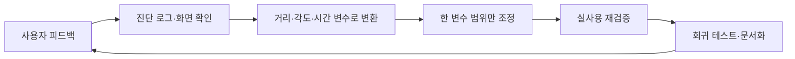

# JARVIS Gaze Tracking — Calibration & Field QA

> 일반 RGB 웹캠의 시선과 손동작으로 기기를 제어하는 팀 프로젝트에서 Gaze Tracking을 담당하고, 사용자 피드백을 calibration 변수와 진단 화면으로 바꿨습니다.

[Team repository](https://github.com/madcamp-official/26s-w3-c3-05) · [Role in project README](https://github.com/madcamp-official/26s-w3-c3-05#팀원) · [Contribution history](https://github.com/madcamp-official/26s-w3-c3-05/commits/main/?author=Westyoon)

## Project info

| Item | Detail |
|---|---|
| Period | 2026.07 |
| Team | 3-person team |
| My role | Gaze Tracking, 사용자별 calibration, 대상 판정과 진단 UI |
| Stack | Python, MediaPipe, OpenCV, PySide6, pytest |
| Demo | 공개 영상 없음; 팀 저장소의 코드와 실행 절차 제공 |

## Executive summary

| Item | Detail |
|---|---|
| Question | 사용자별 시선과 기기 영역을 어떻게 등록하고, 불확실한 시선에서는 실행하지 않게 할까? |
| Role | 얼굴·홍채 추적, 사용자별 기기 등록, 시선 대상 추정, 진단·모니터링 |
| Signals | yaw/pitch, 눈-머리 상대 오프셋, 거리, 얼굴 위치, 시간 안정성 |
| QA focus | calibration coverage, blink/recovery grace, target tolerance, 기기별 영역, 시각적 진단 |
| Tools | Python, MediaPipe, OpenCV, PySide6, pytest |

## Problem observed in use

실사용 환경에서는 다음 문제가 반복되었습니다.

- 깜빡임 뒤 `UNKNOWN` 프레임이 이어져 target dwell이 초기화됨
- 작은 전구는 등록 영역이 너무 좁아 조금만 벗어나도 인식되지 않음
- 큰 모니터와 작은 전구에 같은 판정 반경을 적용하면 한쪽이 과하거나 부족함
- 특정 자세 표본이 부족하면 calibration이 끝나지 않음
- 결과만 보면 사용자가 어디를 봐야 하는지, 왜 거부되었는지 알기 어려움

## From feedback to measurable controls

| Feedback | Variable or diagnostic | Change |
|---|---|---|
| “깜빡인 뒤 대상이 자주 풀린다” | `blink_hold`, `recovery_hold`, `candidate_grace` | 짧은 관측 손실을 제한적으로 흡수 |
| “전구 판정이 너무 빡빡하다” | device-specific `radius_scale` | 작은 기기에만 판정 영역 보정 |
| “등록이 끝나지 않는다” | valid-frame count, coverage condition | 충분한 총 유효 프레임을 근거로 우회 조건 추가 |
| “어디를 봐야 하는지 모르겠다” | registered area + current gaze map | 등록 영역과 현재 시선점을 진단 화면에 표시 |
| “얼굴을 놓치면 화면이 사라진다” | registry-backed target map | 등록 영역은 유지하고 관측 시선점만 숨김 |

## Troubleshooting

### 1. 깜빡임 직후 시선 대상이 반복해서 해제됐습니다

- **Problem:** 짧은 관측 손실마다 dwell이 초기화되어 사용자가 같은 대상을 계속 바라봐도 선택이 끊겼습니다.
- **Root cause:** blink와 recovery 프레임을 일반적인 `UNKNOWN`과 같은 방식으로 처리했습니다.
- **Options considered:** 항상 직전 대상을 유지하는 방식과 제한된 grace 구간만 허용하는 방식을 비교했습니다.
- **Fix:** `blink_hold`, `recovery_hold`, `candidate_grace`로 짧은 손실만 흡수하고, 근거가 부족한 상태에서는 계속 `UNKNOWN`을 반환했습니다.
- **Result:** 오선택 방지 원칙을 유지하면서 깜빡임 직후의 불필요한 초기화를 줄였습니다.

### 2. 크기가 다른 기기에 같은 판정 반경을 적용할 수 없었습니다

- **Problem:** 작은 전구에 맞춘 반경은 모니터에서 좁고, 큰 화면에 맞춘 반경은 전구 주변의 오선택을 늘렸습니다.
- **Root cause:** 기기 크기와 calibration 분산을 무시한 전역 tolerance를 사용했습니다.
- **Fix:** 등록 기기별 `radius_scale`을 적용하고 등록 영역과 현재 시선점을 같은 진단 화면에 표시했습니다.
- **Result:** 기기별 조정 근거를 화면에서 확인할 수 있게 됐으며, tolerance 확대가 항상 정확도 향상은 아니라는 제한도 함께 남겼습니다.

## QA loop

불확실할 때 가장 가까운 기기를 강제로 고르지 않고 `UNKNOWN`을 반환하는 원칙은 유지했습니다. tolerance 조정은 항상 오작동 위험과 함께 확인했습니다.

## Evidence map

| Change | Commit |
|---|---|
| blink/recovery grace와 시선 미니맵 | [`e14228c`](https://github.com/madcamp-official/26s-w3-c3-05/commit/e14228c) |
| calibration 총 유효 프레임 우회 | [`e92c188`](https://github.com/madcamp-official/26s-w3-c3-05/commit/e92c188) |
| 전구별 판정 영역 보정 도입 | [`e089844`](https://github.com/madcamp-official/26s-w3-c3-05/commit/e089844) |
| 등록 영역과 관측 시선점의 표시 분리 | [`48ecf70`](https://github.com/madcamp-official/26s-w3-c3-05/commit/48ecf70) |
| 프로젝트 전체 구조와 역할 | [team README](https://github.com/madcamp-official/26s-w3-c3-05#팀원) |

## Limitations

- calibration은 사용자, 카메라 위치, 거리와 조명에 의존합니다.
- 저장소의 제스처 모델 성능은 팀 전체 결과이며, 이 케이스에서 개인 기여로 주장하는 범위는 Gaze Tracking과 관련 QA입니다.
- tolerance를 넓히면 인식률과 오선택 위험이 함께 바뀌므로 대규모 사용자 평가가 추가로 필요합니다.
- 현재 결과는 일반 웹캠 환경의 프로토타입이며 시선 추적 전용 하드웨어의 정확도를 대체하지 않습니다.

[← Portfolio home](../../README.md)
